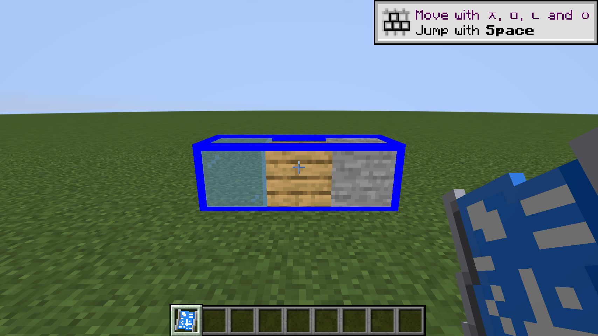

# Portable Blueprints — Fabric 1.21.1

Nimblonia의 Portable Blueprints 2.0.10을 Minecraft 1.21.1 / Fabric으로 옮긴 비공식 포트입니다.

Fabric 연결부는 Kotlin으로 작성했습니다. 원본의 건설·파일 형식·GUI 로직과 리소스는 재사용하고, Mixin은 Java로 유지했습니다.

[설치 파일 다운로드](https://github.com/andyjusa/portable-blueprints-fabric/releases/latest) · [검증 결과](VERIFICATION.md) · [원본과 라이선스](PROVENANCE.md)



## 설치

Release의 `portable-blueprints-fabric-1.21.1-install.zip`에는 포트 JAR와 Fabric API, Fabric Language Kotlin이 들어 있습니다. 압축 안 `mods` 폴더의 JAR 3개를 클라이언트와 서버 양쪽에 설치합니다. Fabric Loader 자체는 런처에서 별도로 설치합니다.

포트 JAR만 내려받았다면 아래 의존 모드도 함께 설치합니다.

- Java 21 이상 / Minecraft 1.21.1
- Fabric Loader 0.20.1 이상
- Fabric API 0.116.7+1.21.1
- Fabric Language Kotlin 1.14.2+kotlin.2.4.21 이상

원본 NeoForge JAR는 함께 넣지 않습니다. 사용하던 월드를 먼저 백업한 뒤 별도 테스트 월드에서 확인하세요.

## 개발

Java 21로 실행합니다.

```sh
./gradlew build
./gradlew runGameTest
./gradlew runSmokeClient
```

`runGameTest`는 개발 전용 Minecraft 서버에서 실행합니다. `runSmokeClient`는 `build/client-smoke`의 별도 개발 인스턴스에서 실행하고 자동 종료합니다. 테스트 코드는 배포 JAR에 포함되지 않습니다.

Fabric API가 등록·통신·이벤트·Transfer 인벤토리를 담당하고, Fabric Language Kotlin이 Kotlin 런타임을 제공합니다. 원본 JSON/.bp 직렬화에는 Minecraft가 제공하는 Gson을 사용합니다.

## 포트 차이

- 설정 파일은 `config/portable_blueprints-client.json`, `config/portable_blueprints-server.json`입니다. NeoForge TOML 설정의 자동 변환은 제공하지 않습니다.
- ProjectE와 Sophisticated Backpacks의 NeoForge 전용 연동은 비활성화했습니다. 일반 Fabric Transfer 인벤토리와 아이템 컨테이너 컴포넌트는 지원합니다.
- 홀로그램은 vanilla/Fabric 모델 렌더 경로를 사용합니다. NeoForge `ModelData`에 의존하는 커스텀 모델까지 동일하게 렌더링하는 것은 보장하지 않습니다.
- 기존 `.bp` 형식과 아이템 ID를 유지했습니다. 모든 타 모드 조합의 호환성을 검증한 것은 아닙니다.

원저작자: **Nimblonia**. 원본 러시아어 번역 기여: **Fugach357**. 공식 배포: https://modrinth.com/mod/portable-blueprints
